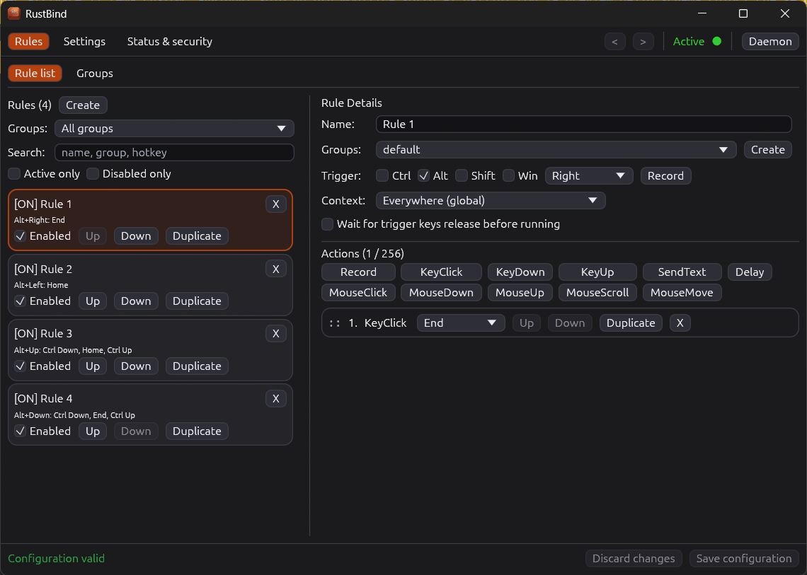
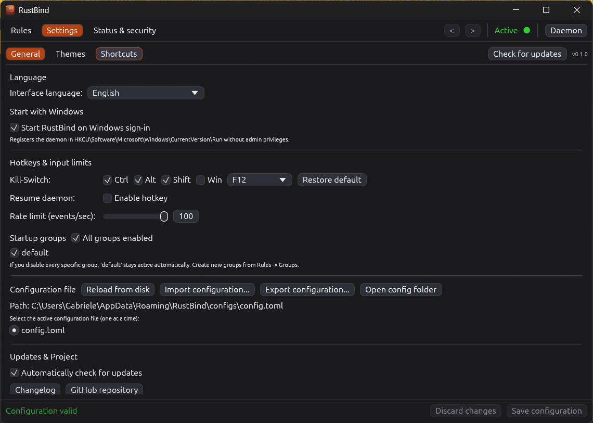
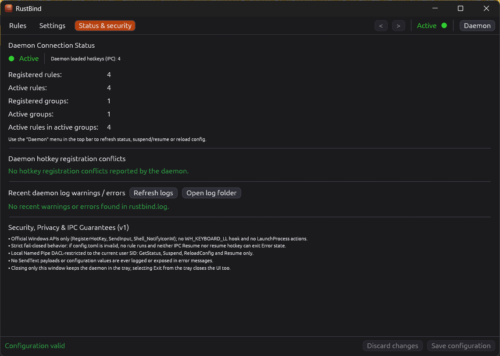

<p align="center">
  
</p>

# RustBind

A lightweight, security-focused **Windows 10/11 hotkey and input automation suite** written 100% in Rust.
RustBind uses only official, documented Win32 APIs (`RegisterHotKey`, `SendInput`, `Shell_NotifyIconW`) with strict fail-closed safety guarantees and zero low-level global hooks or process injection.

<table>
  <tr>
    <td align="center" width="33%">
      <a href="assets/screenshots/rules.png"></a><br />
      <sub><b>Rules &amp; Actions</b></sub>
    </td>
    <td align="center" width="33%">
      <a href="assets/screenshots/settings.png"></a><br />
      <sub><b>Settings &amp; Profiles</b></sub>
    </td>
    <td align="center" width="33%">
      <a href="assets/screenshots/status.png"></a><br />
      <sub><b>Status &amp; Security</b></sub>
    </td>
  </tr>
</table>

---

## Architecture

RustBind separates always-on background execution from configuration into two companion binaries placed in the same directory:

| Binary | Role | Details |
| :--- | :--- | :--- |
| `rustbind.exe` | **Background daemon** | Pure Win32 message loop, system tray icon, hotkey registration, `SendInput` runner, and local Named Pipe IPC server. Single-instance via `Local\RustBind_Daemon_SingleInstance`. |
| `rustbind-ui.exe` | **Ephemeral config UI** | `eframe`/`egui` desktop configurator (`RustBind`). Launches `rustbind.exe` from its own directory if not already running and releases all UI memory on close while the daemon stays in the tray. |
| `rustbindctl.exe` | **CLI controller** | Console utility to query or control the running daemon over local IPC (`status`, `suspend`, `resume`, `reload`). |

> [!IMPORTANT]
> Keep `rustbind.exe`, `rustbind-ui.exe`, and `rustbindctl.exe` in the **same folder**: the daemon and UI launch each other by resolving the sibling executable next to `std::env::current_exe()`.

---

## Key Features

- **Keyboard & Mouse Automation (`schema_version = 1`)**:
  - Hotkey triggers via `RegisterHotKey` with additive pass-through modifier support.
  - Action sequences supporting `KeyClick`, `KeyDown`, `KeyUp`, Unicode `SendText` (UTF-16 surrogate aware), deterministic `Delay`, and mouse actions (`MouseClick`, `MouseDown`, `MouseUp`, `MouseScroll`, relative `MouseMove`).
  - Per-rule modifier-release option (`wait_for_modifier_release`) defaulting to macOS-style remapper behavior.
- **Rules, Multi-Group Assignment & Process Context**:
  - Compact single-line rule cards showing `<Trigger>: <Actions>` preview, top-right `X` delete buttons (with overlap protection on long names), drag-and-drop rule reordering, and drag-and-drop rule-to-actions import with a dimmed action preview.
  - Multi-select groups per rule, bulk group membership editing (`Add` / `Remove`) with column-aligned `"Open"` rule buttons, startup active groups (automatic fallback to `"default"`), an **Active groups** submenu right in the system tray context menu for instant toggling, and duplicate-action cluster cleanup.
  - Optional per-group and per-rule foreground process filters (`Include` / `Exclude` `.exe`, combined as `Groups (OR) && Rule (AND)` while `"default"` hides its delete button and displays a disabled `Everywhere (global)` context selector), plus live daemon registration conflict diagnostics.
- **Visual Configurator (`rustbind-ui.exe`)**:
  - Live trigger capture and live keyboard + mouse action recorder with inline scroll/move editing, column-aligned action rows, hover chip deletion, and undo/redo (`Ctrl+Z` / `Ctrl+Y`).
  - **Drag & drop `.toml` import** anywhere onto the window (when no modal is open) or import/export via native file dialogs — dropped configuration `.toml` profiles are **activated and reloaded in the daemon immediately**, and dropped **Custom Theme `.toml`** files are imported and activated immediately as the custom theme.
  - Single canonical configuration folder (`%APPDATA%\RustBind\configs\`, starting with `config.toml`) with single-click profile switching and fail-closed backup/restore.
  - **5 languages** (English default, Italian, French, German, Spanish) synchronized across both UI and daemon tray menu/tooltips, plus **10 built-in themes** (5 dark including *GTA VI — Vice Sunset*, 5 light, and *True Black* `#000000`) and a full **Custom Theme Editor** (per-element color pickers including base text, dark/light mode, True Black, 4 grouped border-radius sliders, and TOML theme import/export) persisted in `%APPDATA%\RustBind\preferences.toml`.
  - **GitHub Updates & Project Links**: on-demand `"Check for updates"` (in *Settings -> General*), optional automatic update checking with a persistent update notice (`Close`, `Changelog`, `Update`), verified SHA-256 self-update via WinHTTP, and tray notification item (`Update available`) when an update is cached.
  - Clean borderless settings/status sections separated by inset horizontal dividers, with automatic subtab/editor reset when switching top-level tabs.
  - Optional Windows sign-in autostart toggle (`HKCU\...\Run`, no admin rights required).
- **Safety & Privacy by Design**:
  - **Fail-closed startup & reload**: invalid configuration files or an unavailable `kill_switch` (`Ctrl+Alt+Shift+F12` by default) place the daemon in `Error` state with zero active rules without modifying the original file.
  - **Circuit breakers**: max 256 actions/sequence, max 1024 characters for `SendText`, sliding-window rate limiter (`1..=100` events/sec), single active sequence at a time, atomic cancellation, automatic release of pressed keys.
  - **Privacy-first logs & errors**: `SendText` payloads and config values are never written to logs, panic messages, or `ConfigError` output.
  - **Hardened local IPC**: Named Pipe (`\\.\pipe\RustBind-IPC-<UserSID>`) restricted via SDDL DACL to the current user (`TokenUser`) and `PIPE_REJECT_REMOTE_CLIENTS`, accepting only `GetStatus`, `Suspend`, `ReloadConfig`, and `Resume`.
  - **Explicit v1 scope limits**: No `SetWindowsHookEx` (`WH_KEYBOARD_LL`), no single-key remapping without `RegisterHotKey`, no `LaunchProcess` rule action, no memory reading/writing, and no timing randomization/jitter.

---

## Getting Started

### Requirements
- Windows 10 or Windows 11 (`x86_64`)

### Portable Archive
1. Download `rustbind-<version>-windows-x64.zip` from GitHub Releases (optional checksum verification against `rustbind-<version>-windows-x64.sha256.txt`).
2. Extract all files into a single folder (keeping `rustbind.exe`, `rustbind-ui.exe`, and `rustbindctl.exe` together).
3. Launch `rustbind-ui.exe` (it automatically starts `rustbind.exe` in the tray if needed) or launch `rustbind.exe` directly and right-click the tray icon -> **Configure...**.

### Per-User Installer (Optional, No Admin Required)
- Run the interactive `.msi` installer (`Scope="perUser"`, defaulting to `%LOCALAPPDATA%\Programs\RustBind` with customizable install path, MIT license prompt, optional `rustbindctl.exe` CLI component and user `PATH` toggle, Start Menu / Desktop shortcuts, optional Windows sign-in autostart, automatic close of running RustBind processes on upgrade/uninstall, and `"Launch RustBind"` completion checkbox), or install from source via `cargo xtask`:
  ```powershell
  cargo xtask install
  ```
  To remove binaries and the Start Menu shortcut (preserving `%APPDATA%\RustBind\`):
  ```powershell
  cargo xtask uninstall
  ```

> [!NOTE]
> **Windows SmartScreen**: Release binaries are currently unsigned. On first launch, Windows Defender SmartScreen may display an "Unknown publisher" prompt (*More info* -> *Run anyway*). Building from source avoids this prompt.

---

## CLI Usage (`rustbindctl.exe`)

```text
rustbindctl.exe status   # Query daemon state (active | paused | error) and active rule count
rustbindctl.exe suspend  # Pause rule execution and cancel any running sequence
rustbindctl.exe resume   # Resume execution from paused state (blocked if daemon is in error)
rustbindctl.exe reload   # Trigger fail-closed reload of the active .toml config in the daemon
```

Daemon optional flag:
- `rustbind.exe --debug-log`: enables `DEBUG` logging for tray notification codes (excluding `WM_MOUSEMOVE` and any input payload).

---

## Data Locations

| Artifact | Default Location |
| :--- | :--- |
| Active & custom `.toml` configs | `%APPDATA%\RustBind\configs\` (`config.toml` by default) |
| Active config marker | `%APPDATA%\RustBind\.active_config` |
| UI theme & language preferences | `%APPDATA%\RustBind\preferences.toml` |
| Logs | `%LOCALAPPDATA%\RustBind\logs\rustbind.log` |
| Runtime diagnostics | `%LOCALAPPDATA%\RustBind\runtime_diagnostics.json` |
| Update check cache | `%LOCALAPPDATA%\RustBind\update_cache.toml` |

---

## Building & Packaging from Source

Requires the Rust MSVC toolchain (`x86_64-pc-windows-msvc`) and Windows 10/11 SDK (`rc.exe` is used by `build.rs` when available to embed `assets/rustbind.ico`).

```powershell
# Verify formatting, lints, and workspace tests
cargo fmt --check
cargo clippy --workspace --all-targets --all-features -- -D warnings
cargo test --workspace

# Build portable release bundle in dist\
cargo xtask package --run-tests

# Also build per-user MSI installer (requires WiX Toolset v4+ `wix` CLI with WixToolset.UI.wixext & WixToolset.Util.wixext)
cargo xtask package --run-tests --build-msi
```

For architectural and threat-model details, see [docs/ARCHITECTURE.md](docs/ARCHITECTURE.md).

---

## License

Licensed under the [MIT License](LICENSE).
